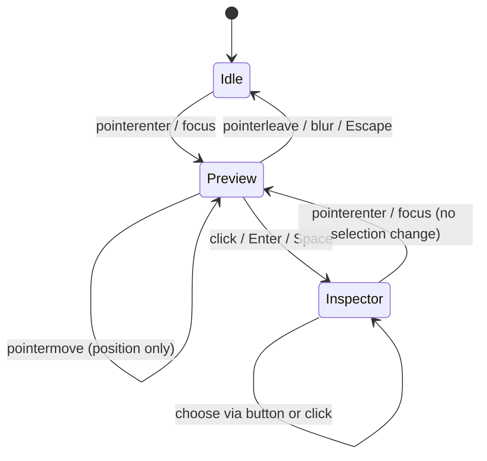
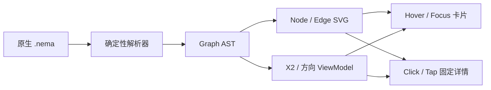

# NEMA v1.1 / Website R3 — Node–Edge Hover Renderer Design

**状态**：人类渲染器详细设计和网站参考实现，非 NEMA 协议升级。

## 1. 用户目标与明确边界

- Node 悬停时立即显示 X2 描述；Edge 悬停时立即显示 X2 描述，同时标明 X1 名称和真实方向。
- **数据真源**：来自解析器已验证的 Graph AST；不得通过名称猜测描述、方向或端点。
- 不修改 `.nema`、`.nemat`、Graph 数据、选中节点或领域修订；悬停仅为瞬时展示。
- 点击（或 Enter / Space）才更改当前详情检查器的选中对象。无 X2 时显示可选占位。
- UI 文本本地化（zh / ja / en）；保持英文专有标识符的精确大小写 `\=LoginAPI`。

## 2. 字段映射

| 项目 | 必需渲染字段 | 描述来源 | 典型悬停内容 |
|---|---|---|---|
| Node `A` | Node ID=`A`、X1=`LoginAPI` | X2=`Authentication` | `A · LoginAPI` / `Authentication` |
| Edge `A>X>B` | Edge ID=`X`、X1=`Reads`、source=`A`、target=`B` | X2=`Verify session` + 后续纵向意群 | `X · Reads` / `A → B` / `Verify session` |
| Edge `B<Y<C` | ID=`Y`、X1=`Notifies` | X2=`Audit event` | `Y · Notifies` / **`C → B`** / `Audit event` |
| Edge `A=U=C` | ID=`U`、X1=`Shares` | X2=`Security policy` | `U · Shares` / `A — C` / `Security policy` |
| Edge `A>P>A` | ID=`P`、X1=`Retry` | X2=`Maximum 3 attempts` | `P · Retry` / `A → A` / `Maximum 3 attempts` |

X2 是**可选说明**，不存在时显示本地化的「未填写 X2（可省略）」。X2 不是连接目标，不是关系类型；不影响箭头、节点数或图权重。

## 3. 交互状态机



- 悬停卡片跟随位置，优先在指针右下显示，空间不足时在上方显示，X 方向限制在图视口内。
- SVG Node 元素 `role=button,tabindex=0`；Edge 的透明命中线 (`edge-hit`) 与实际可见路径分离，保证细连线可操作。
- Tooltip `role=tooltip`，只用 `textContent` 写入解析后的纯文本，避免 HTML 注入；`pointer-events:none`，防止自身打断 hover。
- 屏幕阅读器通过各元素的 `aria-label` 获取名称、方向与描述；Tooltip 不独占键盘焦点。
- 键盘 `Tab` 在元素间导航，焦点出现时展示同样预览，Escape 隐藏；Enter/Space 选中并打开常驻详情面板。
- 触屏没有 hover，因此主页**点击直接进入常驻详情**；Graph 指南页轻触时固定预览，在手机视图排至图形下方，重复点击关闭。
- Tooltip 与固定检查器分离：前者瞬时、后者不会在鼠标离开时消失。

## 4. 参考架构与输入输出



```ts
type GraphHoverVM = {
  kind: 'node' | 'edge';
  id: string;
  name: string;   // X1，保留精确字面量
  description?: string; // X2 + 同列纵向意群，非摘要推断
  source?: string;
  target?: string;
  direction?: 'directed' | 'undirected';
};
function resolveEndpoints(x0: string): { source: string; target: string; directed: boolean } {
  // A>X>B => A→B; B<Y<C => C→B; A=U=C => A—C
  throw new Error('Use the canonical NEMA parser; do not infer from layout');
}
```

展示层只消费解析器给出的标准 AST，不能再次推断 Graph 语法。不同 Agent 的并行变更需要按领域版本 / hash 更新 ViewModel；正在展示的旧 Hover 应在视图更新时失效并重新获取。

## 5. 性能与安全

- 鼠标移动只改 Tooltip 位置，不重新解析源文件、不重新生成 Graph、不请求 AI。超大图后续可采用 requestAnimationFrame 合并 pointermove，并按可见子图虚拟化。
- 避免将机密凭证全文放在 UI tooltip：IDE 可在本地配置敏感字段脱敏；规范的 X2 默认显示语义描述，但产品应提供遮蔽策略与授权开关。
- X2 可能很长：允许自动换行；桌面设置最大宽度、必要时由详情面板展示完整正文；不截断原始数据。
- 低认知负荷：不在 Hover 中重复列出 X0–X5 全字段，不随悬停重排图，不改变节点坐标和连线方向。
- `prefers-reduced-motion` 依从系统设置，避免强制动画。

## 6. 验收要点

| ID | 场景 | 预期 |
|---|---|---|
| GH-01 | hover Node A | 显示 `Authentication`；图与选中不变 |
| GH-02 | hover Edge X | 显示 `Verify session` 和 `A → B` |
| GH-03 | hover Edge Y | 显示 **`C → B`** 而非 B→C |
| GH-04 | hover Edge U | 显示 `A — C`，无方向箭头 |
| GH-05 | pointerleave / Escape | 悬停卡片隐藏 |
| GH-06 | Tab focus / Enter | 先预览，后选中常驻详情 |
| GH-07 | 移动端轻触 | 进入详情；Graph 指南页固定预览不遮挡其他图元素 |
| GH-08 | zh / ja / en | 语言切换后说明、标签本地化且不篡改数据 |
| GH-09 | X2 缺省 / 长说明 | 显示明确可选占位 / 不改变 AST |
| GH-10 | 并发刷新 | 换图后旧 tooltip 不污染新的图实体 |

## 7. 集成分工

**IDE1.0**：在 `ide-shell-web`、`ide-shell-desktop` 的 Graph 展示组件复用相同 ViewModel 与交互状态机，数据由 Rust `nema-codec` AST 提供；UI 可以通过 TypeScript 前端实施，但不得重新实现文字拼接语法。

**IME1.0**：只负责输入 / 智能自动转换 / 缓存，不接管 IDE 的 Graph Hover；当 IME 自身提供只读关系候选视图时复用该 ViewModel，不能更改 IME 自动转换优先级。

**Token 影响**：仅改变前端读取与展示 X2 的方式，没有新增 NEMA 字段或协议字符；旧 Token 实测值仍可引用，不得宣称因 Hover 增减了压缩率。

## 8. R4 五轮审查补充：焦点与平行 Edge

- **重建后焦点连续性**：选择 Graph Node/Edge 会重绘 SVG 和选择列表，必须在新节点上依据 `kind + id` 恢复焦点。不能让焦点意外落到 BODY。`Enter/Space` 选择后，屏幕阅读器可继续访问同一对象。
- **可访问标签页**：三模式切换必须具有 `role=tablist` + `role=tab` + `role=tabpanel`，按 Right/Left/Home/End 选择模式；切换更新 `aria-selected`、`tabindex` 和 `aria-labelledby`。
- **语言同步**：切换 zh/ja/en 时刷新 Node/Edge 的 `aria-label` 与图表可访问名称，AST 自身的专有名词、X2 说明不被翻译改写。
- **并行边几何**：基于无序端点对计算稳定的法线/通道偏移，再依据每条边的真正 source/target 确定箭头方向。两条相反方向边不能因各自法线翻转重叠；多个自循环使用不同控制点。
- **无副作用**：悬停仅调整 Tooltip 与高亮，选中才更新检查器，既不修改代码/图数据，也不触发 AI 调用。图重绘后悬停旧组件必须自动作废。
- **安全**：只用 `textContent` 展示解析结果，禁止将 X2 拼成 `innerHTML`。涉及秘密时由产品端配置脱敏策略，网页示例不包含真实凭证。

详细缺陷、验证方法与适用范围参阅 `WEBSITE_REVIEW_R4_FIVE_ROUNDS.md`。
