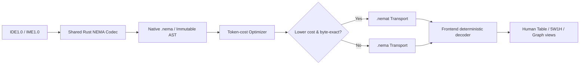

# NEMA v1.4 · 基本设计

## 架构边界

UI 各自持有编辑态；Rust 编解码器为唯一编码逻辑，Python 为协议参考模型。编解码后必须比对 SHA-256 和 AST 语义；输出格式由明确的 MIME 类型 `application/vnd.nema+text` 或 `application/vnd.nemat+text` 判断。AI 可以学习并直接书写压缩串，但输入容错由客户端控制。

### 领域与行的状态机
`Initial → optional Manifest → DomainHeader → TableHeader? → Record → Continuation* → (DomainHeader|Record) → EOF`。只有默认 Table 的第一个内容行可用 `\\ ` 定义表头。Graph 和 5W1H 不接受 Table 头。`TAB` 保留控制行，不允许正文以原始 TAB 起始；`n` 个行首空格归属 X(n−1)。

### 字典与字段类型
字典项是 opaque 字符串，在自然语言渲染时不做大小写断词。文本统一 Unicode，渲染与源文件是不同对象。字段/记录的底层 AST 使用二维 `groups: string[][]`，不能只保存渲染后的句子；否则纵向意群无损恢复将失败。

### 并行与故障处理
Graph 节点/边有稳定 ID，领域含 revision。写入必须检查 `(documentHash, domainRevision, ownerEpoch)`，重试前重新解析，不允许多个进程先验修改同一领域。IME 接管为默认自动保存到可撤销事务；IDE 只有手动转换触发时请求临时写租约。编码异常或 Token 优化不可靠时原生回退，绝不部分替换文件。

## 开放问题（明确不伪装已经解决）
PascalCase 与缩写的分词对所有自然语言不能保证唯一；需要共享字典标记或留原文。表格“第一列为空”的场景需要行 ID 或扩充语法，不可误把所有缩进行当新记录。二次压缩和流式超大文件需要产品级 Rust 实现额外验证。
